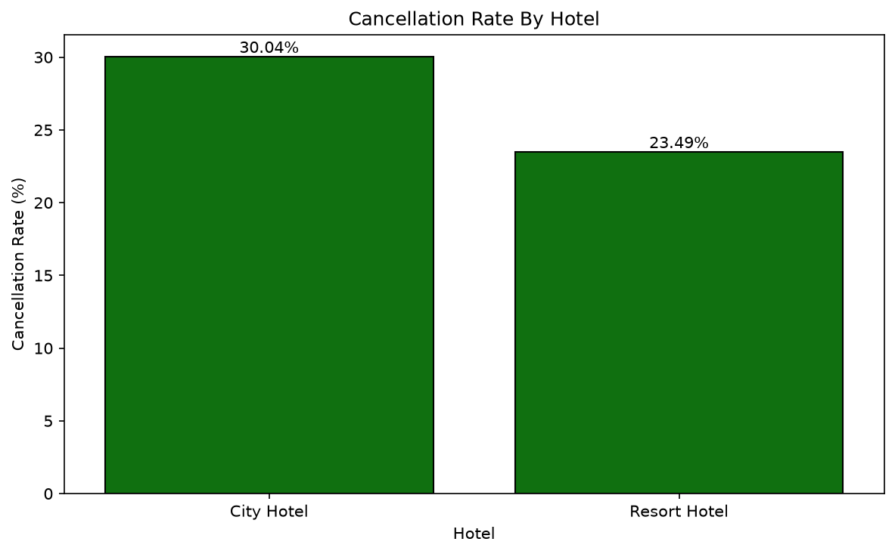
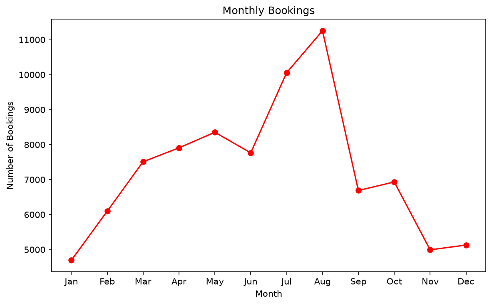
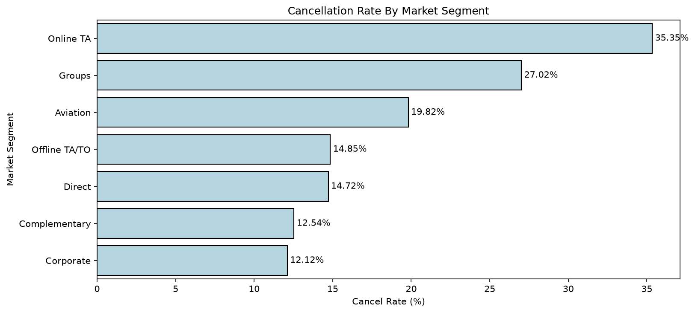
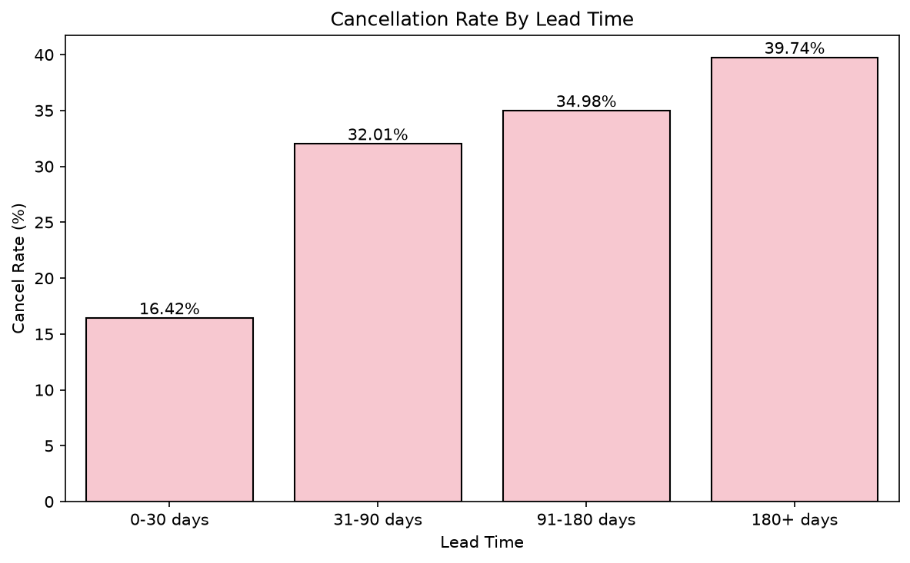
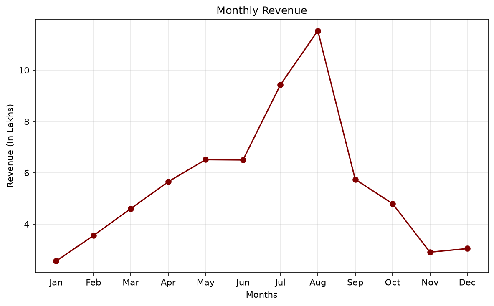
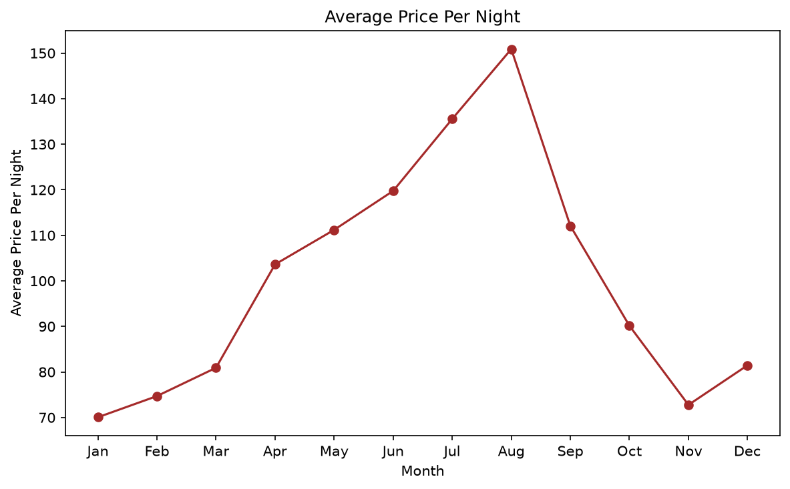

# Hotel Booking Analysis: Understanding Cancellations and Revenue

An end-to-end data analysis project using **Python, Pandas, NumPy, Matplotlib, Seaborn and MySQL** to find out why hotel bookings get cancelled and how revenue changes through the year.

## Problem Statement

Why do hotel bookings get cancelled, and what can the hotels do to reduce cancellations and grow revenue?

## Dataset

- **Source:** Hotel Booking Demand dataset (Kaggle)
- **Size:** 119,390 bookings, 32 columns (City Hotel and Resort Hotel)
- **After cleaning:** 87,387 bookings, 36 columns

## Tools Used

| Purpose | Tool |
|---|---|
| Data cleaning and analysis | Python, Pandas, NumPy |
| Database and queries | MySQL (joins, grouping, CASE WHEN) |
| Visualization | Matplotlib, Seaborn |
| Environment | Jupyter Notebook |

## Project Structure

```
hotel-booking-analysis/
├── data/
│   ├── hotel_bookings.csv
│   └── hotel_bookings_clean.csv
├── notebooks/
│   ├── 01_cleaning.ipynb
│   ├── 02_sql_analysis.ipynb
│   └── 03_visualization_insights.ipynb
├── sql/
│   └── queries.sql
├── images/
└── README.md
```

## Approach

1. **Data cleaning** (`01_cleaning.ipynb`)
   - Dropped `company` (about 94% missing values)
   - Filled missing `agent` with 0 (no agent), `country` with "Unknown" and `children` with 0
   - Removed about 32,000 duplicate rows (the dataset has no booking ID, so identical rows were treated as duplicates)
   - Removed bookings with zero guests, negative price and one extreme price outlier (`adr` of 5400)
   - Created new columns: `total_nights`, `total_guests`, `revenue` (adr x nights), `arrival_month_num`, `season`
2. **SQL analysis** (`02_sql_analysis.ipynb`)
   - Loaded the cleaned data into MySQL and analysed cancellations by hotel, lead time, market segment, customer type, country and deposit type
3. **Visualization** (`03_visualization_insights.ipynb`)
   - Built charts for cancellation rates, monthly bookings, monthly revenue and average price per night

## Key Findings

1. **The overall cancellation rate is 27.49%.** Roughly 1 in every 4 bookings gets cancelled.
2. **Lead time has a strong effect on cancellations.** Bookings made 0-30 days in advance have a 16.42% cancellation rate, while bookings made 180+ days in advance have 39.74%.
3. **Online TA is the biggest booking source and also the biggest source of cancellations.** It accounts for about 59% of bookings, has a 35.35% cancellation rate, and contributes about 76% of all cancellations. Direct (14.72%) and Corporate (12.12%) bookings cancel far less.
4. **City Hotel has a higher cancellation rate than Resort Hotel** (30.04% vs 23.49%).
5. **Portugal (PRT) dominates the data.** About 31% of bookings come from PRT, its cancellation rate is 35.67%, and about 41% of all cancellations originate there.
6. **Revenue is highly seasonal.** August earns the most (11.54 lakh) and January the least (2.56 lakh). The average price per night also roughly doubles between January and August.

### Charts

**1. Cancellation rate by hotel**


**2. Monthly bookings**


**3. Cancellation rate by market segment**


**4. Cancellation rate by lead time**


**5. Monthly revenue (non-cancelled bookings)**


**6. Average price per night by month**


## Recommendations

1. **Pay attention to long-lead bookings.** Bookings made 180+ days ahead cancel the most, so reminders or reconfirmation steps could help.
2. **Monitor the Online TA channel closely.** Most cancellations come from there, so a separate cancellation policy for this channel is worth considering.
3. **Promote Direct and Corporate bookings.** These channels have much lower cancellation rates.
4. **Use different strategies for peak and off-season.** Focus on capacity and pricing in August, and on offers to lift bookings in November-January.

## Limitations

- The Non Refund deposit category is small (about 1.2% of bookings) and almost entirely from Portugal, so no conclusion was drawn about deposit policy.
- This is an analysis of a single dataset, and correlation does not imply causation.

## How to Run

1. Download the dataset from Kaggle and place `hotel_bookings.csv` in the `data/` folder.
2. Install the libraries: `pip install pandas numpy matplotlib seaborn mysql-connector-python jupyter`
3. Run the notebooks in order: `01_cleaning`, `02_sql_analysis`, `03_visualization_insights`.
4. In `02_sql_analysis.ipynb`, replace `YOUR_PASSWORD` with your own MySQL password.

## Author

**Aman Sharma**